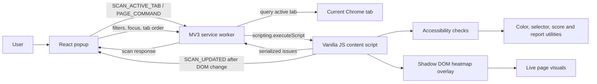

# Accessibility Heatmap Overlay

A Manifest V3 Chrome extension with a React/Vite popup and a vanilla JavaScript content script. It scans the current page, scores the findings, and highlights affected elements without changing the page's own elements or styles.

## Features

- WCAG AA contrast thresholds: 4.5:1 for normal text and 3:1 for large text, including translucent and inherited background colors.
- Checks for missing image alt text, form labels, accessible names, heading hierarchy, small click targets, document language, and keyboard focus.
- Shadow DOM heatmap with severity colors, issue-type filters, explanatory hover tooltips, and scroll-to/pulse issue navigation.
- Accessibility score, visual keyboard tab-order map, and JSON/printable HTML report exports.
- Automatic rescans after DOM changes; heatmap boxes stay aligned on scrolling and resizing.
- Dark and light popup themes.
- No backend. The overlay is read-only and does not change the page's own elements or styles.

## System architecture



### Responsibilities

- **Popup (`src/popup/`)**: React interface for starting scans, browsing/filtering findings, showing the weighted score, toggling the heatmap/tab-order visualization, and exporting reports.
- **Service worker (`src/background/service-worker.js`)**: Routes popup requests to the active tab and injects the bundled content script using `activeTab` and `scripting`.
- **Content script (`src/content/`)**: Runs checks in the page's isolated extension context, retains element references, serializes issue metadata, watches for page changes, and handles overlay interactions.
- **Checks (`src/checks/`)**: Independent modules return findings in the shape `{ element, type, severity, message, fix }`.
- **Utilities (`src/utils/`)**: Color parsing and contrast math, stable element selectors, report serialization, and score calculation.
- **Overlay**: A fixed, pointer-events-none host with a Shadow DOM. It draws boxes over affected elements and provides hover explanations without styling or intercepting the page's elements.

## Working flow

1. The user opens the popup and selects **Scan Page**.
2. The popup sends `SCAN_ACTIVE_TAB` to the service worker. The worker locates the active tab, injects `dist/assets/content.js`, then asks the content script to scan.
3. The content script runs each check against visible page elements. Contrast uses computed text colors and composites translucent backgrounds through the ancestor chain; thresholds follow WCAG AA for normal and large text.
4. Findings retain their DOM element references in the content script. The script creates the Shadow DOM heatmap and sends serializable issue details (including selectors) back to the popup.
5. The popup displays the issue list and a score. The score starts at 100 and subtracts 15 per critical, 8 per serious, and 3 per minor finding, with a floor of 0. This is a prioritization aid, not a WCAG conformance score.
6. Popup controls send commands through the service worker to filter/hide the overlay, visualize keyboard tab order, or scroll to and pulse-highlight an issue. Hovering the affected page element opens a tooltip with context and a suggested fix.
7. A debounced `MutationObserver` reruns checks after relevant DOM changes and refreshes the overlay. Scroll and resize events reposition the boxes.
8. The popup can export the current findings as JSON or as a printable HTML report.

The focus-indicator check is a best-effort inspection of computed default outlines and accessible CSS focus rules; dynamic focus styles may not always be inferable without focusing controls.

## Install and run

1. Install Node.js and npm.
2. Run `npm install`.
3. Run `npm run build`.
4. Open `chrome://extensions` and enable **Developer mode**.
5. Choose **Load unpacked** and select the generated `dist` folder.
6. Open a web page, click the extension, then choose **Scan Page**.

To run the focused utility tests:

```sh
npm test
```

## Demo page

Start the Vite server:

```sh
npm run dev -- --host 127.0.0.1
```

Then open `http://127.0.0.1:5173/test-page/` in Chrome and scan it to see deliberate accessibility issues.

## Screenshots

Screenshots can be added here after capturing the popup and heatmap in Chrome.
